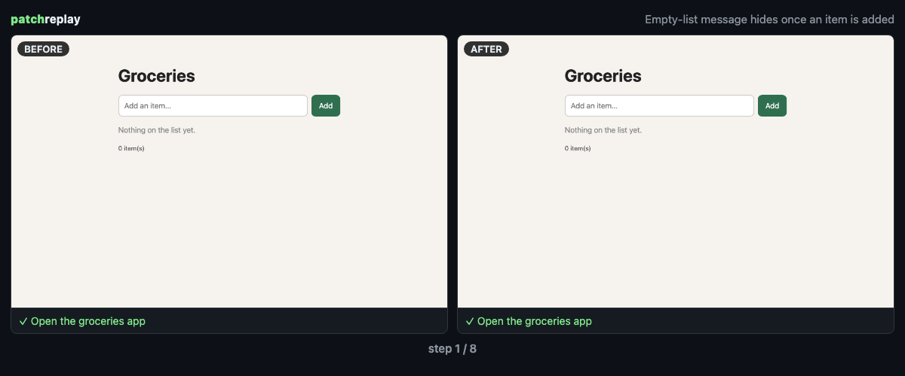

# patchreplay

**エージェントが「直しました」と言ったら、その証拠を再生しよう。**

patchreplay は、AI エージェントの変更**前**と変更**後**のアプリに同じブラウザ操作を実行し、何が変わったかを正直に報告します。前後を並べた GIF、動画付きレポート、PR に貼れる Markdown を生成します。

[English](README.md) | [日本語](README.ja.md)



- **設定も既存テストも不要。** Vite アプリの前後2バージョンを起動します。普段使っているエージェント（Claude Code / Codex）に短い確認手順を書かせ、両方で実行します。
- **判定は正直に出します。** `✅ fixed` になるのは、変更前が検証（assert）の手順まで進んでそこで失敗し、変更後は成功した場合だけです。ページが読み込めない、クリックできないといった失敗は `⚠️ 判定不能` とし、「直った」とは言いません。ほかの結果は `➖ 差なし`、`❌ 変更後が失敗`、`📷 撮影のみ`、`☑️ 変更後のみ（基準なし）` です。
- **作業中のファイルには触れません。** スナップショットは一時 index 経由で git オブジェクトとして保存し、実行は使い捨ての worktree で行います。
- **[herdr](https://github.com/herdrdev/herdr) と組み合わせると便利です。** エージェントのペインが1ターン終えるたびに、自動で記録します。herdr なしでも使えます。

## 必要なもの

- Node 20 以上、git、ログイン不要の Vite アプリ。動作確認は macOS（Apple Silicon）、herdr 0.9.5、Node 24、Vite 7 で行いました。Linux でも動くはずですが、未検証です。
- 確認手順を自動で書かせるには、Claude Code か Codex CLI がインストール済みでログインしている必要があります。どちらもない場合は、画面の撮影だけになるか、自分で書いた手順を使います。
- 初回は Playwright の Chromium（約100MB）をダウンロードします。1回の記録は1〜2分ほどで、その半分ほどは確認手順の生成にかかります。

## データの送り先

ビルド、dev サーバー、ブラウザ、レポートはすべて手元のマシンで完結します。例外は確認手順の生成だけです。1回の記録ごとに **1回だけ**、普段お使いのエージェント CLI（`claude -p` または `codex exec --sandbox read-only`）を呼び出します。その CLI が、**設定されているモデル提供元**（Anthropic や OpenAI など）に次の内容を送ります。

- diff
- 依頼内容のタイトル
- 変更後ページのアクセシビリティツリー
- herdr で使う場合は、エージェントのターミナルの直近の出力

この呼び出しは、通常の利用と同じく利用枠を消費します。何も送りたくない場合は、`--generator none` を付けるか、自分で書いた `.patchreplay/scenario.json` を使ってください。ターミナルの出力はこの呼び出しにだけ使い、レポートには書き込みません。プロンプトを保存するのは `PATCHREPLAY_DEBUG=1` を付けたときだけです。

## すぐ試す

```sh
# エージェントが未コミットの変更を加えた Vite アプリで
npx patchreplay run --open
```

既定では作業ツリーと `HEAD` を比較します。エージェントの1ターンだけを記録したい場合は、指示を出す前に基準を保存します。

```sh
npx patchreplay baseline        # エージェントに指示する前
# … エージェントが編集 …
npx patchreplay run --open
```

監視させることもできます。編集が10秒止まると、自動で記録します。

```sh
npx patchreplay watch --dir
```

出力先は `.patchreplay/runs/<id>/` です（自動で git の除外設定に追加します）。

| ファイル | 内容 |
|---|---|
| `replay.gif` | 前後を左右に並べた GIF。1手順1コマで、最後に判定を表示 |
| `report.html` | 前後の動画、スクリーンショット付きの手順表、コンソールエラー、PR 用テキスト |
| `replay.md` | PR に貼る Markdown（先に `replay.gif` をコメント欄へドラッグ） |
| `scenario.json` | 実行した確認手順。`.patchreplay/scenario.json` に置くと固定できます |

## herdr プラグイン

```sh
herdr plugin install maromocooo/patchreplay
herdr plugin pane open --plugin patchreplay --entrypoint watch
```

**watch** タブがすべてのエージェントのペインを見守ります。Vite リポジトリでエージェントが作業を始めると基準を保存します。作業が終わると前後を再生し、herdr の通知で結果を知らせます。タブ1つで、すべてのワークスペースを監視できます。

記録中に別のターンが終わった場合は、待ち行列に入れます。そのターンは、直前に検証した状態を基準にして次に再生するので、検証されないまま基準に紛れ込むことはありません。記録が失敗した場合も、その変更は次回の記録の対象として残ります。

| エントリ | 種類 | 内容 |
|---|---|---|
| `watch` | tab | エージェントのターン終了ごとに自動で記録 |
| `run` | popup | フォーカス中のエージェントのリポジトリで今すぐ記録 |
| `open-latest` | action | 最新のレポートを開く |
| `baseline` | action | 今の状態を基準として保存 |

## 仕組み

1. 作業ツリー（未追跡ファイルを含み、ignore 対象は除く）を一時 index 経由で commit 化し、`refs/patchreplay/*` に固定します。index・HEAD・ファイルには触れません。
2. 前後のバージョンを一時 worktree に展開し、`node_modules` はリンクで共有します。
3. dev サーバーを空きポートで1つずつ起動します。
4. 生成役のエージェントに diff・依頼内容・変更後ページのアクセシビリティツリーを渡し、最大25手順の確認を書かせます。実行前に内容を検証します。
5. Playwright で同じ手順を前後両方に実行し、動画と各手順のスクリーンショットを撮ります。
6. 判定は検証（assert）の結果だけから出します。見た目がそれらしい動画だけでは成功扱いにしません。

## 制約（v0.1）

- 対象はログイン不要の Vite アプリです。他の dev サーバーも `--dev-cmd` で動く可能性はありますが、未検証です。
- 生成された確認手順が間違っていることもあります。レポートには、実行した手順を必ず載せます。重要な確認は `.patchreplay/scenario.json` で固定してください。
- 前後で lockfile が変わっている場合、リンクした `node_modules` が変更前の状態と合わないことがあります。
- 対応 OS は macOS と Linux です。

MIT © maromocooo
