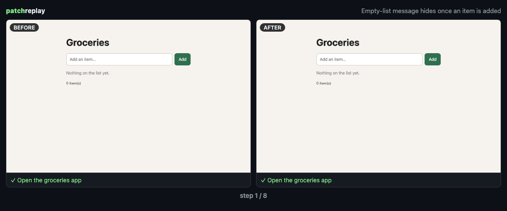

# patchreplay

**Your agent said "fixed." Here's the replay.**

patchreplay records the same browser steps against your app **before** and **after** an AI agent's change, then tells you, honestly, what changed. You get a side-by-side GIF, a video report, and a Markdown block you can paste into your PR.

[English](README.md) | [日本語](README.ja.md)



- **No config, no existing tests needed.** patchreplay starts both versions of your Vite app, asks the coding agent you already use (Claude Code or Codex) to write a short check, and runs it on both.
- **Honest verdicts.** `✅ fixed` only when *before* reaches an assertion and fails it, and *after* passes. A page that didn't load or a click that couldn't happen gives `⚠️ inconclusive`, never "fixed". The other results are `➖ no difference`, `❌ after fails`, `📷 captured only` and `☑️ after only (no baseline)`.
- **Never touches your work.** Snapshots are git objects written through a temporary index; both versions run in throwaway worktrees.
- **Built for [herdr](https://github.com/herdrdev/herdr).** When an agent pane finishes a turn, patchreplay records the proof automatically. It also works without herdr.

## Requirements

- Node 20+, git, and a Vite app that runs without logging in. Verified on macOS (Apple Silicon) with herdr 0.9.5, Node 24 and Vite 7. Linux should work but is untested.
- To have the check written for you, [Claude Code](https://claude.com/claude-code) or [Codex CLI](https://github.com/openai/codex) must be installed and logged in. Without one, you get a plain capture, or you can write the scenario yourself.
- The first run downloads Playwright's headless Chromium (about 100 MB). A replay takes about 1–2 minutes, about half of it spent writing the check.

## What is sent where

Builds, dev servers, browsers and reports all stay on your machine. The one exception is writing the check: patchreplay makes **one headless call per replay** to the agent CLI you already use (`claude -p` or `codex exec --sandbox read-only`). That CLI sends the following to **its configured model provider** (for example Anthropic or OpenAI):

- the diff
- the task title
- the AFTER page's accessibility tree
- in herdr mode, the last lines of the agent's terminal

That call counts against your plan or API usage like any other prompt. To send nothing, use `--generator none` or your own `.patchreplay/scenario.json`. Terminal excerpts are used for that call only. They are never written to reports, and the prompt is saved only with `PATCHREPLAY_DEBUG=1`. Reports stay in `.patchreplay/` until you share them.

## Quick start (any terminal)

```sh
# in a Vite app with uncommitted changes from your agent
npx patchreplay run --open
```

By default it compares your working tree with `HEAD`. To capture exactly one agent turn, save a baseline first:

```sh
npx patchreplay baseline        # before you prompt the agent
# … agent edits files …
npx patchreplay run --open
```

Or let it watch: once edits go quiet for 10 seconds, it records automatically.

```sh
npx patchreplay watch --dir
```

Output goes to `.patchreplay/runs/<id>/` (git-excluded automatically):

| File | What |
|---|---|
| `replay.gif` | Side-by-side before/after, one frame per step, verdict at the end |
| `report.html` | Both videos, a step table with screenshots, console errors, PR snippet |
| `replay.md` | Paste into your PR (drag `replay.gif` into the comment box) |
| `scenario.json` | The check that ran. Copy it to `.patchreplay/scenario.json` to pin it |

## herdr plugin

```sh
herdr plugin install maromocooo/patchreplay
herdr plugin pane open --plugin patchreplay --entrypoint watch
```

The **watch** tab follows every agent pane. When an agent in a Vite repo starts working, patchreplay saves a baseline. When the agent settles, it replays before and after and shows a herdr notification. One tab watches all your workspaces.

If an agent finishes another turn while a replay is recording, that turn is queued and replayed next against the state that was just verified. Nothing is silently folded into a baseline. If a replay fails, its changes stay pending for the next run.

| Entry point | Kind | What |
|---|---|---|
| `watch` | tab | Auto-record every finished agent turn |
| `run` | popup | Record now for the focused agent's repo |
| `open-latest` | action | Open the latest report for the focused agent |
| `baseline` | action | Save a baseline for the focused agent now |

Bind the popup to a key in `~/.config/herdr/config.toml` if you like:

```toml
[[keys.command]]
key = "prefix+P"
type = "plugin_action"
command = "patchreplay.open-latest"
```

## Options

```
patchreplay run [--base <ref>] [--task <text>] [--scenario <file>]
               [--generator claude|codex|none|auto] [--dev-cmd "<cmd with {port}>"]
               [--no-gif] [--open]
```

- `--generator none` skips the agent and records a plain page capture (`📷 captured only`).
- `--dev-cmd` handles non-Vite servers, for example `--dev-cmd "npm run dev -- --port {port}"`.

### Scenario format

```json
{
  "title": "Empty state hides after adding an item",
  "expectation": "Adding an item hides the empty-state message",
  "steps": [
    { "action": "goto", "path": "/" },
    { "action": "fill", "role": "textbox", "value": "Oat milk" },
    { "action": "click", "role": "button", "name": "Add" },
    { "action": "expectHidden", "text": "Nothing on the list yet." }
  ]
}
```

Actions: `goto`, `click`, `dblclick`, `hover`, `fill`, `press`, `wait`, `waitFor`, `scroll`, `setViewport`, `expectVisible`, `expectHidden`, `expectText`, `expectCount`. Target elements with `role` + `name`, `text`, or `selector`.

## How it works

1. **Snapshot.** The working tree, including untracked files and excluding ignored ones, is written as a git commit through a temporary index and pinned under `refs/patchreplay/*`. Your index, `HEAD` and files are never touched.
2. **Worktrees.** Before and after are checked out into temporary worktrees, with `node_modules` linked from your checkout.
3. **Servers.** Each version's dev server starts on its own free port. They run one at a time.
4. **Check.** The generator sees the diff, the task and the after page's accessibility tree, and returns at most 25 steps. patchreplay validates them before running anything.
5. **Replay.** Playwright runs the same steps on both versions and records video and per-step screenshots.
6. **Verdict.** Computed from assertion results only. A good-looking video is never treated as a pass.
   - If dependencies changed between the two versions, the verdict carries a visible caveat.
   - Generated scenarios are validated before they run: `goto` only accepts paths on your app, and leaving the app's origin ends the run.
   - Ctrl-C stops dev servers and removes worktrees.

## Limits (v0.1)

- Vite apps without login. Other dev servers work through `--dev-cmd`, but they are untested.
- A generated check can be wrong, and the report always shows what ran. If a check matters, pin it with `.patchreplay/scenario.json`.
- If the lockfile changed between before and after, the linked `node_modules` may not match the before version.
- macOS and Linux.

## Develop

```sh
npm install && npm test
herdr plugin link "$PWD"
```

MIT © maromocooo
